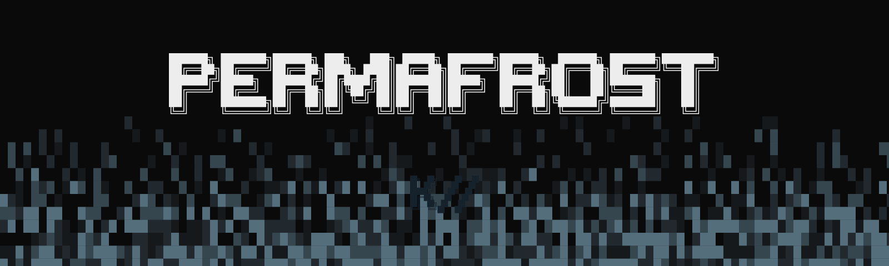
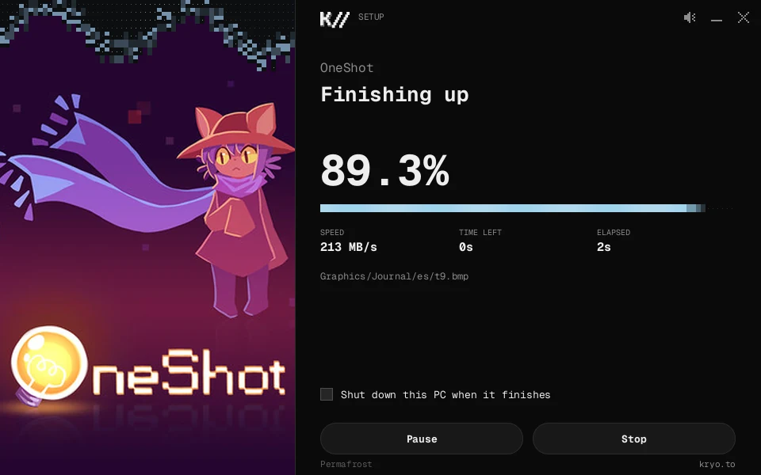
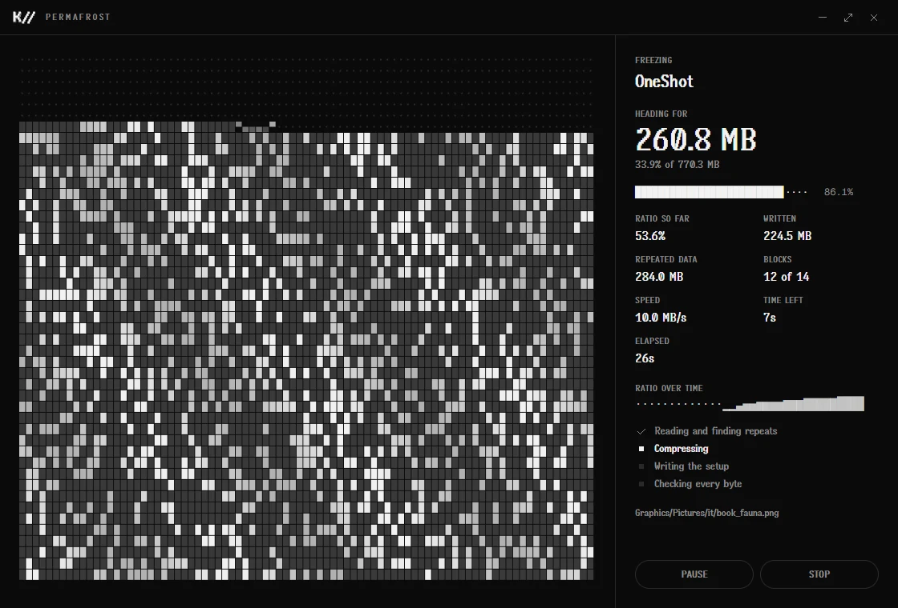
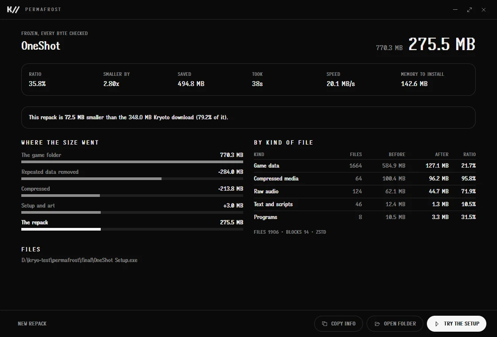

<p align="center"></p>

# Kryoto Permafrost

Freeze a game folder into a `.kryo` repack: much smaller than the game, with its own setup that
thaws it back bit for bit. Windows.

**Kryoto** · Rust, Tauri 2 + React · MIT · [Download](https://github.com/Kryoto-Dev/kryoto-permafrost/releases/latest) · [All repos](https://github.com/Kryoto-Dev)

How to use it: [docs/usage.md](docs/usage.md). What's in a `.kryo`: [docs/format.md](docs/format.md).



## What it does

**Squeezes harder than an archive.** Most of a game is already compressed, so a plain archiver
barely touches it. Permafrost goes after what it can reach:

- **Repeated data** is found across the whole game, however far apart, and stored once.
- **PNGs, zipped assets and zlib streams** are opened up, compressed properly, and rebuilt exactly
  at install time.
- **JPEGs** are recompressed, about a fifth smaller, with no change to a single pixel.
- **Programs** go through an x86 filter, **PCM audio** through a delta filter, and **text** through
  PPMd where it wins.
- Like files sit together in **solid LZMA2 blocks**, with settings tried against each block.

**Never breaks a game.** When a freeze finishes, the repack is decoded and compared with the game
folder, every byte. The setup checks every block as it installs, and can read back every file.

**Shows its working.** An estimate before you start, the ratio and projected size as it runs, and
afterwards where the size went, step by step and by kind of file.





**Knows Kryoto.** Find a game on Kryoto and the title, version, program and cover fill themselves
in. The results page compares the repack with the Kryoto download.

**Makes a setup worth running.** No Inno, no installer framework: a 2 MB program of its own that
needs nothing installed. Your cover art sits frozen in ASCII ice and melts as
the game unpacks. It carries the game's icon, and a tune of its own, or yours.

**Does what repackers do.** Optional languages and bonus content as separate downloads. Split
parts for upload limits. Runtimes installed quietly. Shortcuts, an uninstaller, the Windows
programs list. Pause, and carry on after a stop, on both the freeze and the install. A limit on
memory for weak PCs. Silent installs.

## How small

OneShot, 770 MB, on 6 threads with 8 GB of memory. Every repack was checked byte for byte.

| | Size | Ratio | Time |
|---|---|---|---|
| 7-Zip, `-mx=9` | 249.0 MB | 32.3% | 1m 46s |
| Frost | 272.6 MB | 35.4% | 44s |
| Deep Freeze | 214.0 MB | 27.8% | 6m 34s |
| Absolute Zero | 212.8 MB | 27.6% | 10m |

How far a game goes depends on what's in it. Absolute Zero's bigger dictionary pays off on bigger
games, not ones this size. Music and video that are already compressed stay about the same size
here: they were 95 MB of that 213. A game shipped as one packed or encrypted file, like Ultimate
Custom Night, barely moves (99%), with any tool.

## Quick start

Install Node 22+, pnpm 10 and Rust's MSVC toolchain, then:

```powershell
pnpm install --frozen-lockfile
pnpm app:dev       # run it
pnpm app:build     # target/release/kryoto-permafrost.exe
```

## Layout

| Path | What's there |
|---|---|
| `crates/kryo/` | the format: freezing, thawing, codecs |
| `crates/setup/` | the setup players run, drawn pixel by pixel |
| `crates/cli/` | `permafrost`, for scripts and batch runs |
| `src/`, `src-tauri/` | the app |
| `art/` | the art, rendered by `pnpm brand` |

## Checks

```powershell
pnpm stub      # the app embeds the setup, so build it first
pnpm check
```

## Release

Bump the version in `package.json`, `Cargo.toml` and `src-tauri/tauri.conf.json`, add a dated
`CHANGELOG.md` entry and push to `main`. CI publishes the executables with their SHA-256. A
version whose heading still says `unreleased` is not published.

## More

[CONTRIBUTING.md](CONTRIBUTING.md) · [SECURITY.md](SECURITY.md) · [THIRD_PARTY.md](THIRD_PARTY.md) · [MIT license](LICENSE)
